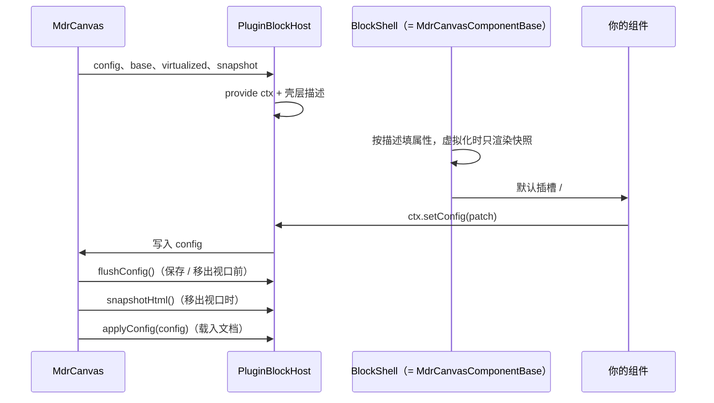
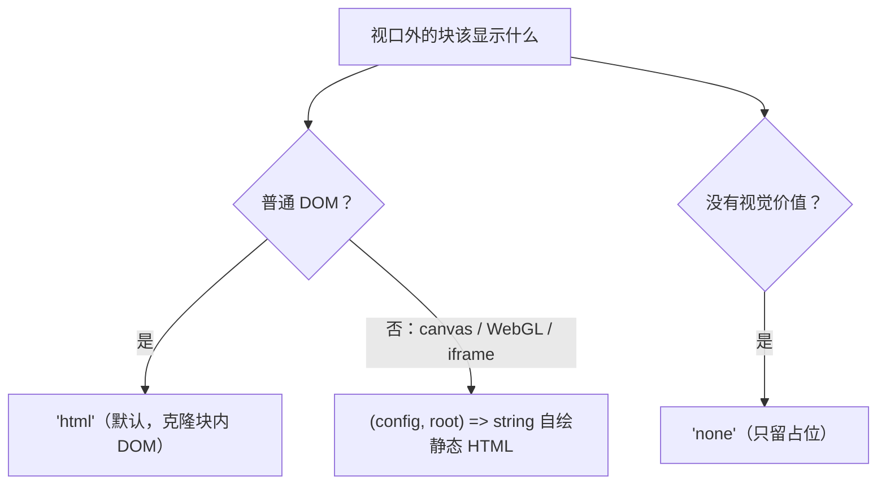

<!-- 最后验证: 2026-10-24 -->
# 04 生命周期与快照

## 谁在什么时候调你



你需要关心的只有三件事：

1. 组件挂载时 `ctx` 已可用；
2. 写配置用 `ctx.setConfig`，不要管什么时候保存；
3. 视口外块会被销毁，重建后 `config` 原样回来（块内滚动位置也会还原）。

## 视口外显示什么



```ts
// 默认：克隆块内 DOM
snapshot: 'html'

// 自绘：canvas、WebGL、iframe 必须用这个，DOM 克隆是空白
snapshot: (config, root) => `<div class="chart">${config.title}</div>`

// 无视觉价值：只留占位
snapshot: 'none'
```

- 快照必须**同步**返回。
- 返回值仍会过 `sanitizeSnapshot`（去掉 `contenteditable` / `tabindex`）。
- 块内 `<textarea>` 的克隆值恒为空（Vue 用 property 写 value），依赖可见层渲染内容。

## 内容驱动高度

```ts
const syncAutoHeight = () => {
  const el = scrollEl.value
  if (!el) return
  ctx.resizeTo({ h: Math.ceil(el.offsetHeight + CONTENT_EXTRA) })
}
```

- 高度会被 `constraints.minHeight + 8` 钳制，内容不足时停在最小高。
- 光标跟随：`getView()` 判断是否超出视口底部，再 `panBy`；`isPanning` 为 `true` 时跳过。
- 尺寸变化后的联结传播与重叠推挤由画布处理，块不要自己写布局。

## 只读与移动端

- `ctx.readOnly` 为 `true` 时：画布隐藏拖拽栏与设置栏，块内输入控件要自己禁用。
- `ctx.isCompact` 为 `true` 时画布处于移动端堆叠布局，可据此切紧凑样式。
- 只读不要只靠 CSS：内部编辑器/输入框需要真正禁用，否则键盘仍可写入。
