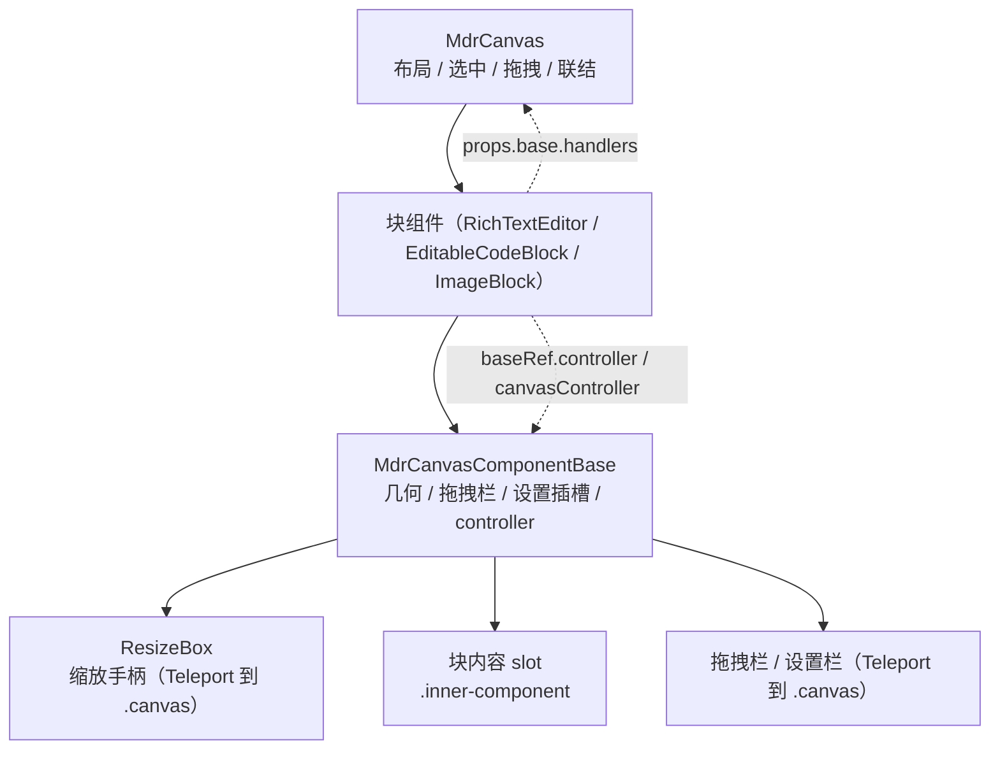

<!-- 最后验证: 2026-10-18 -->
# 画布组件开发指南

> 面向新增块类型的开发者。目标：只写「这个块是什么」，不碰画布几何、会话与浮层。
> 流程类文档见 [../flow/README.md](../flow/README.md)。

## 图 1 一个块的分层



- **MdrCanvas 只认通用协议**：`componentMap`、注册表、`base` props、controller。
- **块组件负责自身语义**：config 映射、图标/标题、尺寸可变性、设置 UI、内容驱动的高度。
- **base 负责通用能力**：定位、手柄、拖拽栏、设置浮层、贴合遮罩、z 层、Teleport。

## 块组件最小结构

```vue
<template>
  <MdrCanvasComponentBase ref="baseRef" v-bind="props.base" :icon="mdiWidgets" :title="LABEL"
    :width-changable="props.base.compact !== true">
    <div v-if="!virtualized" class="my-block inner-component">…</div>
    <div v-else class="virtual-snapshot inner-component" v-html="snapshot" />
    <template #settings>…</template>
  </MdrCanvasComponentBase>
</template>

<script lang="ts">
export const MY_LABEL = '我的组件'
// 高度会随内容变化时声明 false，联结传播不会改它的高度
export const isHeightChangable = (config: MyConfig) => true
</script>

<script setup lang="ts">
const props = defineProps<MdrCanvasComponentContentProps<WidgetConfig> & {
  virtualized?: boolean
  snapshot?: string
}>()

const baseRef = ref<{ controller: BlockComponentController; canvasController: BlockCanvasController } | null>(null)
</script>
```

## base props（`MdrCanvasComponentBaseProps`）

| 属性 | 说明 |
| --- | --- |
| `uuid` | 块唯一标识，放置时生成、持久化在 `.mdrf`，并输出到根元素 `data-uuid` |
| `x` `y` `width` `height` | content 坐标与尺寸 |
| `minWidth` `minHeight` `maxWidth` `maxHeight` | 已含画布内边距的尺寸约束 |
| `widthChangable` / `heightChangable` | 该轴是否允许被联结/手柄改变；`false` 时对应手柄自动收掉 |
| `icon` / `title` | 拖拽栏图标与文字，由块组件传入 |
| `draggable` / `readOnly` | 只读态不显示拖拽栏与设置栏 |
| `compact` | 画布移动端模式，块可据此切紧凑布局 |
| `active` / `dragging` / `popupOpen` | 选中、拖拽中、编辑器 popup 遮挡态 |
| `showHandle` / `showSettings` | 浮层归属由画布决定，块组件原样透传 |
| `handles` | 画布给出的手柄集合（base 再按 changable 收窄） |
| `zIndex` / `zoom` / `placement` | 层级、画布缩放、浮层在上/下方 |
| `cornerStyle` / `masks` | 贴边圆角与虚线遮罩，画布计算 |
| `handlers` | 申请画布操作的底层回调（见下） |

## 控制器契约

`canvasComponentControllers.ts` 提供两套接口：

| 控制器 | 方法 | 用途 |
| --- | --- | --- |
| `BlockComponentController` | `moveBy(dx, dy)` | 移动自身（联动联结块） |
| | `resizeTo({ width?, height? })` | 改变尺寸（含联结传播与重叠推挤） |
| | `getSize()` / `getChangeable()` | 读取当前尺寸与可变形 |
| `BlockCanvasController` | `panBy(dx, dy)` | 平移画布 |
| | `zoomTo(z)` | 改变缩放（0.5–3） |
| | `getViewData()` | `zoom / pan / origin / viewport / block / isPanning` |

**获取方式（重要）**：base 对后代 `provide`，同时 `defineExpose({ controller, canvasController })`。块组件是 base 的**父组件**，`inject` 只能向下，所以块组件必须用模板 ref：

```ts
const baseRef = ref<{ controller: BlockComponentController; canvasController: BlockCanvasController } | null>(null)
baseRef.value?.controller.resizeTo({ height })
```

子级组件（编辑器内部、NodeView）仍可正常 `inject`。

## 注册表（`canvasComponents.ts`）

`CANVAS_COMPONENTS` 是唯一注册入口：组件本体、添加菜单信息、尺寸约束与能力声明都写在同一项里，
`ComponentKey`、`componentMap`、`constraintsOf` 均由它自动派生。

| 字段 | 必需 | 说明 |
| --- | --- | --- |
| `key` | 是 | 持久化在 `.mdrf` 中，不可随意改；`ComponentKey` 由注册项字面量推导 |
| `label` / `icon` / `addId` | 是 | 添加按钮文案、图标与 DOM id |
| `component` | 是 | 组件本体；重型依赖用 `defineAsyncComponent` 包裹后再填这里 |
| `constraints` | 否 | 尺寸约束，缺省走画布默认值 |
| `defaultConfig` / `defaultSize` | 是 | 新块初始配置与尺寸 |
| `widthChangableOf` / `heightChangableOf` | 否 | 由 config 推导尺寸可变性（缺省 `true`） |
| `acceptsDrop` | 否 | 可作为画布拖拽落点（富文本为 `true`） |
| `toNode` | 否 | 块配置 → 富文本内节点（把块拖入富文本） |
| `extractFromNode` | 否 | 富文本节点 → 块配置（把节点拖出成块） |

注册项经 `defineCanvasComponent<自身 config 类型>()` 包裹，回调参数直接得到精确类型，不需要 `as` 断言。

## 接入清单

1. 新建组件，根为 `MdrCanvasComponentBase`，内容节点带 `inner-component`。
2. 声明 `config` 类型并加入 `WidgetConfig` 联合。
3. 在 `CANVAS_COMPONENTS` 追加一项（`defineCanvasComponent<自身 config 类型>`），填 `component`、`constraints`、`defaultConfig`、`defaultSize` 与可选能力。
4. 需要画布操作时用 `baseRef` 取 controller。
5. 需要保存/加载时 `defineExpose({ saveConfig, loadConfig })`。
6. 需要拖入落点时提供 `resolveDropAtElement(el, preferBefore)` 与 `scrollContent(deltaY)`，并登记 `acceptsDrop`。
7. 运行 `bunx vue-tsc --noEmit`，并在浏览器实操选中、拖拽、缩放手柄与只读态。

## 组件私有文件（`mdrfcd://`）

组件需要附件、图片或大数据时用 `src/utils/componentDataStore.ts`，文件落在当前 `.mdrf` 归档的
`ComponentsData/<组件 UUID>/` 下，随笔记一起保存。

```ts
import { ComponentDataStore } from '../../../utils/componentDataStore'

const store = new ComponentDataStore() // 默认取编辑页写入的当前笔记
const url = store.urlOf(props.base.uuid, 'assets/data.json')
await store.writeFile(url, JSON.stringify({ rows }))
const rows = JSON.parse(await store.readText(url))
const files = await store.listFiles(props.base.uuid)
```

| 方法 | 说明 |
| --- | --- |
| `urlOf(uuid, path)` | 生成 `mdrfcd://<笔记名>/<UUID>/<相对路径>` |
| `writeFile(url, string \| Uint8Array)` | 写入文本或二进制，单文件上限 64 MiB |
| `readFile(url)` / `readText(url)` | 读二进制 / UTF-8 文本 |
| `listFiles(uuid 或根 URL)` | 列出该组件目录下的相对路径 |
| `deleteFile(url)` / `hasFile(url)` | 删除（不存在时无操作）/ 是否存在 |

注意：

- URL 自带笔记名，可安全存进 `config`；不要手写字符串，统一用 `urlOf`。
- 路径不得含 `..`、反斜杠与平台非法字符；组件 UUID 只允许字母、数字、`-`、`_`。
- 写入会重打整个 `.mdrf`，别在逐帧或高频输入里调用，缓存/防抖后再写。
- 只读态由组件自行判断（`props.base.readOnly`），store 不做拦截。

## 虚拟化约定

- 画布传入 `virtualized` 与 `snapshot`；块组件在 `virtualized` 时只渲染快照，不挂真实实例。
- 被克隆的内容必须带 `inner-component` 类，画布按 `.drag-wrapper[data-uuid] .inner-component` 取节点。
- 快照需 `display: contents`，并让整棵子树 `pointer-events: none`（克隆里的交互层会吞事件）。
- 销毁前画布调用 `saveConfig()` 写回内容；块内滚动由画布按类名记录并还原。

## 内容驱动尺寸（自动高度模式）

```ts
const syncAutoHeight = () => {
  if (!autoHeight.value) return
  const height = Math.ceil(scrollEl.offsetHeight + CONTENT_EXTRA)
  baseRef.value?.controller.resizeTo({ height })
}
```

- 高度会被 `constraintsOf` 的 `minHeight + 8` 钳制，内容不足时停在最小高。
- 光标跟随：`getViewData()` 判断光标是否超出视口底部，再 `panBy(0, -over)`；拖拽平移期间 `isPanning` 为 `true`，应跳过。
- 尺寸变化后的联结传播与重叠推挤由画布 `applyBlockSize` 统一处理，块组件不要直接写 layout。

## 常见坑

- 块组件不能 `inject` base 的 controller（方向反了），必须用 ref。
- `title` / `icon` 由块组件自己定义，注册表 label 只用于添加菜单。
- 拖拽栏/设置栏必须 Teleport 到 `.canvas`，放进块内会被 `.drag-wrapper` 的 z 层压住。
- 只读态不要只靠 CSS：画布会隐藏浮层，组件还须给编辑器传自身的 `readOnly` 开关。
- 尺寸可变性只影响「联结与手柄」，组件自己调用 `resizeTo` 不受 `widthChangable` / `heightChangable` 限制。

## 维护提示

- 新增 base props / controller 方法 → 同步本表与 [../flow/02-contracts.md](../flow/02-contracts.md)
- 新增注册表能力 → 同步本表的字段说明
- 改动虚拟化约定 → 同步 [../flow/05-block-lifecycle.md](../flow/05-block-lifecycle.md)
