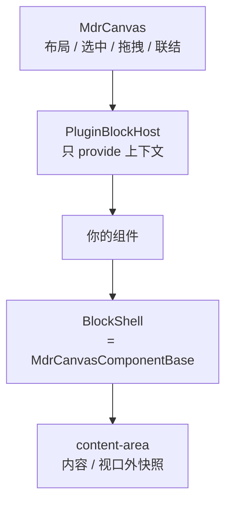

<!-- 最后验证: 2026-10-25 -->
# 画布块开发

一个块 = **两个同名文件 + 自动注册**。第一次写块从 [01 快速上手](01-quick-start.md) 开始。

## 文档导航

| 文档 | 什么时候看 |
| --- | --- |
| [01 快速上手](01-quick-start.md) | 第一次写块，照着抄 |
| [02 BlockContext](02-context.md) | 想知道块里能调什么 |
| [03 块定义](03-definition.md) | 写 `Xxx.block.ts` 时查字段 |
| [04 生命周期](04-lifecycle.md) | 搞清谁什么时候调你、视口外显示什么 |
| [05 设置面板](05-settings.md) | 要给块加设置项 |
| [06 私有文件](06-files.md) | 要存图片、附件、大文本 |
| [07 常见坑](07-pitfalls.md) | 卡住了、提交前自查 |

## 一个块的分层



- 画布只管布局、选中、拖拽、联结。
- `BlockShell` 管尺寸、手柄、拖拽栏、设置菜单、虚拟化。
- 你的组件只管内容和设置。

## 文件结构

```text
Components/
  TodoBlock.block.ts   定义：显示名、图标、默认尺寸、初始配置
  TodoBlock.vue        组件：根是 BlockShell
```

`Registry/canvasComponents.ts` 用 `import.meta.glob` 自动收集所有 `*.block.ts`，并按同名 `.vue`
懒加载组件——新增块不用改注册表。

## 最小示例

```vue
<template>
  <BlockShell>
    <div class="hello">{{ ctx.config.text }}</div>
  </BlockShell>
</template>

<script setup lang="ts">
import BlockShell from '../Sdk/BlockShell.vue'
import { useBlockContext } from '../Sdk/blockContext.ts'

const ctx = useBlockContext<{ text: string }>()
</script>
```

完整可跑版本（含定义文件与设置面板）见 [01 快速上手](01-quick-start.md)。

## 内置块

| key | 添加菜单 | 数据 | 说明 |
| --- | --- | --- | --- |
| `RichTextEditor` | 富文本 | `config.content` | ProseMirror 文档；可接收拖入 |
| `EditableCodeBlock` | 代码块 | `config.code` / `language` | 可拖进富文本（`embed`） |
| `ImageBlock` | 图片 | `config.path` + `ctx.files` | 平铺与自动尺寸 |
| `FileBlock` | 附件 | `config.name` / `mime` / `size` + `ctx.files` | 归档内固定 `file.bin`；图片内联预览，桌面端可另存 |
| `LinkBlock` | 链接 | `config.url` / `title` / `description` / `imageUrl` | 前端抓 og 标签，跨域失败退回手填 |
| `TableBlock` | 表格 | `config.rows` / `header` | 矩形保证；Enter 沿列下移；可拖入富文本 |
| `TaskListBlock` | 任务 | `config.title` / `tasks` | 勾选、续写、进度 |
| `CanvasTestBench` | 测试台 | — | 调试用，`order: 90` 排在最后 |

## 相关

- 画布流程与坐标：[../flow/README.md](../flow/README.md)
- 块 SDK 源码：`src/Controls/Canvas/Sdk/`
- 参考实现：`Components/CanvasTestBench.block.ts` + `CanvasTestBench.vue`
