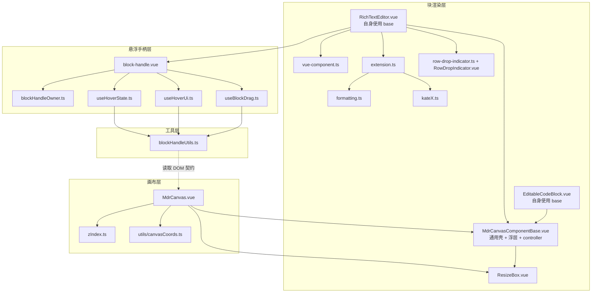
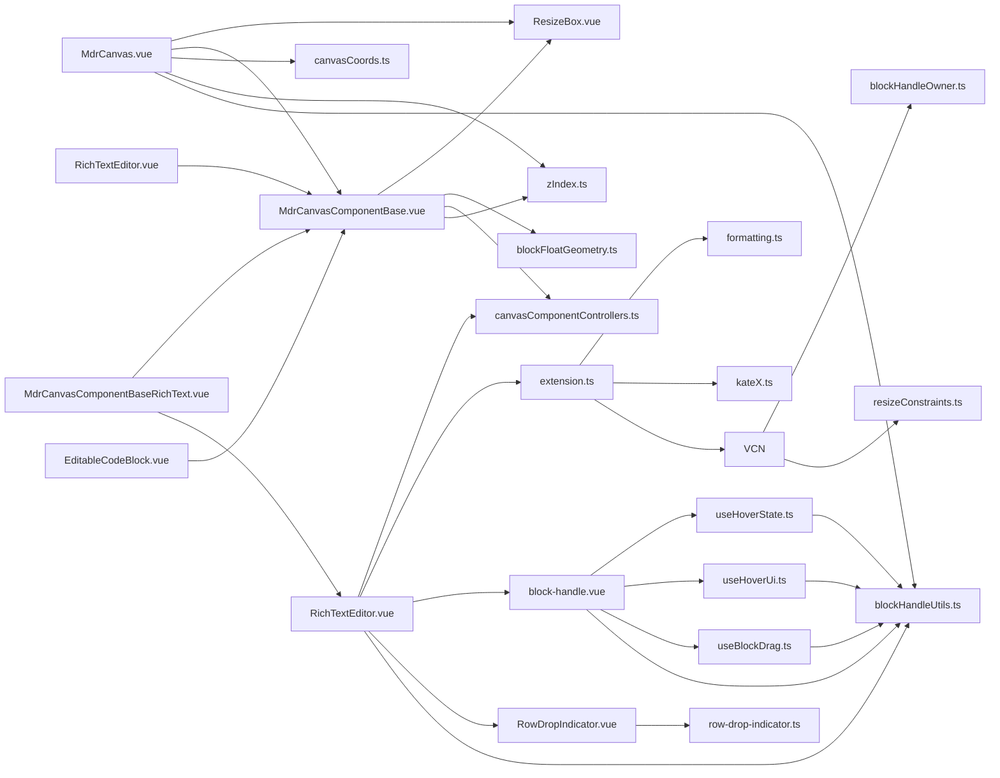

<!-- 最后验证: 2026-10-17 -->
# 00 系统全景

## 心智模型

1. **MdrCanvas.vue 是唯一状态源**：块布局、选中、链接、缩放都在这里。
2. **跨组件通信靠两套契约**：`Mindrizzle:*` CustomEvent + DOM 选择器（详见 02-contracts）。
3. **坐标系是最大认知负担**：画布侧 content/screen/visual 三态，编辑器侧 layout/viewport 两态。

## 图 0.1 系统全景

## 图 0.2 import 依赖图

## 层职责

- **画布层**：MdrCanvas 管布局/会话/缩放；zIndex 定层；canvasCoords 管换算。
- **块渲染层**：MdrCanvasComponentBase 提供通用壳（尺寸、拖拽栏、设置插槽、controller）；具体块组件（RichText/Code）只关心自身 config、可变形与设置 UI；ResizeBox 提供缩放手柄；RichTextEditor 承载 ProseMirror。
- **浮层几何**：blockFloatGeometry 是拖拽栏/设置栏/遮罩几何与 z 的唯一来源，画布命中测试与 basRichTextEditor / EditableCodeBlock 在自己的定义里使用 base，并自行处理 config、可变形、设置 UI 与自动高度；ResizeBox 提供缩放手柄。
- **浮层几何**：blockFloatGeometry 是拖拽栏/设置栏/遮罩几何与 z 的唯一来源，画布命中测试与 base 渲染共用。
- **控制器契约**：canvasComponentControllers 定义块内组件向画布申请移动/改尺寸/平移/缩放/读视图的接口（provide/inject），自动高度与光标跟随都由块组件自己调用
- **工具层**：blockHandleUtils 是编辑器侧唯一坐标与几何入口。

## 维护提示

- 新增文件 → 更新图 0.1、0.2
- 新增跨层依赖 → 检查是否应该走事件而不是 import
- 新增块类型 → 按 [../components/README.md](../components/README.md) 的接入清单登记