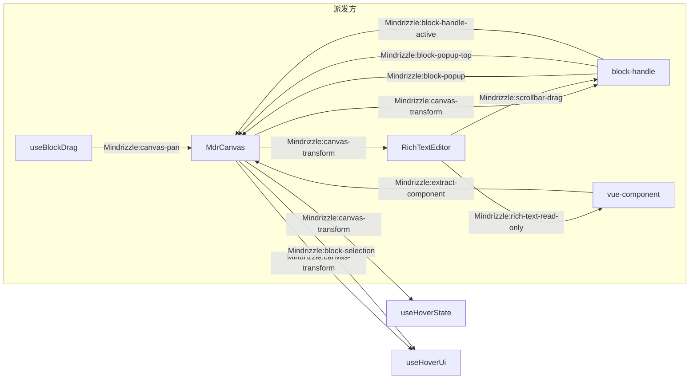
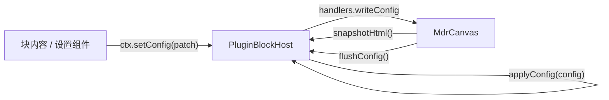
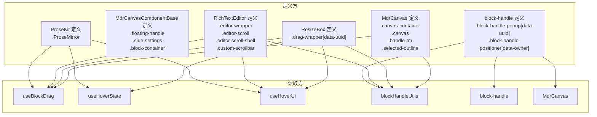

<!-- 最后验证: 2026-10-24 -->
# 02 跨组件契约

> 这个系统真正的接口不是函数签名，而是**事件名和 DOM 选择器**。改任何名字前先查这两张表。

## 图 2.1 CustomEvent 契约

### 事件明细

| 事件名 | 派发方 | 监听方 | 目的 |
|---|---|---|---|
| `Mindrizzle:canvas-transform` | MdrCanvas | RichTextEditor / block-handle / useHoverState / useHoverUi | pan/zoom 变化 |
| `Mindrizzle:block-selection` | MdrCanvas | useHoverUi | 块选中变化 |
| `Mindrizzle:block-popup` | block-handle | MdrCanvas | popup 遮挡 tm 手柄 |
| `Mindrizzle:block-popup-top` | block-handle | MdrCanvas | popup 上方开启 |
| `Mindrizzle:block-handle-active` | block-handle | MdrCanvas | popup 激活 |
| `Mindrizzle:canvas-pan` | useBlockDrag | MdrCanvas | 拖拽贴边驱动画布平移 |
| `Mindrizzle:extract-component` | vue-component | MdrCanvas | 插入组件拖出成块 |
| `Mindrizzle:rich-text-read-only` | RichTextEditor | vue-component | 只读态同步 |
| `Mindrizzle:scrollbar-drag` | RichTextEditor | block-handle | 滚动条拖拽时收 popup |

## 图 2.3 块 SDK 契约（`src/Controls/Canvas/Sdk/`）

| 宿主调用 | 块侧实现 | 用途 |
| --- | --- | --- |
| `snapshotHtml()` | 按 `snapshot` 声明返回静态 HTML（函数形式可读块内 DOM） | 虚拟化 |
| `flushConfig()` | 返回内存中的 config | 保存与虚拟化前落库 |
| `applyConfig(config)` | 覆盖内存 config | 载入文档 |
| `resolveDropAtElement` / `scrollContent` | 由块组件调 `ctx.setDropHandlers` 注册 | 接收画布拖入 |
| `ctx.getView()` | 读画布视图 | 插件不接触 DOM 坐标与原始事件 |

- 块组件根是 `BlockShell`（`MdrCanvasComponentBase` 的自动属性版），设置面板写 `#settings` 插槽；`useBlockContext()` 取 ctx。
- 虚拟化由壳统一：`virtualized` / `snapshot` 经 `BlockShell` 传给 `MdrCanvasComponentBase`，块内不再写 `v-if`。
- `titleOf` / `iconOf` 让拖拽栏标题随 config 变化，缺省用注册项的 `title` / `icon`。
- 富文本内嵌组件按 `embed.nodeName` 反查同一注册表（`embeddedBlockOf`），不再有第二份组件映射。
- 块定义经 `import.meta.glob('../Components/**/*.block.ts')` 自动注册，组件按同名 `.vue` 异步加载。

## 图 2.2 DOM 选择器契约

### 选择器明细

| 选择器 | 定义处 | 读取方 |
|---|---|---|
| `.canvas-container` | MdrCanvas | useBlockDrag / blockHandleUtils / useHoverState |
| `.canvas` | MdrCanvas | block-handle（Teleport 目标） / blockHandleUtils |
| `.drag-wrapper[data-uuid]` | ResizeBox | 几乎全部 |
| `.component-settings-menu` | MdrCanvasComponentBase | 块设置菜单（挂 body、视觉坐标） |
| `.editor-wrapper` | RichTextEditor | useBlockDrag / useHoverUi |
| `.editor-scroll` | RichTextEditor | blockHandleUtils / useHoverUi |
| `.ProseMirror` | ProseKit | 所有 hook |
| `.block-handle-popup[data-uuid]` | block-handle | block-handle / useBlockDrag |
| `.block-handle-positioner[data-owner]` | block-handle | blockHandleUtils |
| `.handle-tm` / `.floating-handle` / `.side-settings` | MdrCanvas（`.handle-tm`）/ MdrCanvasComponentBase（浮层） | useHoverState / useHoverUi |
| `.custom-scrollbar` / `.editor-scroll-shell` | RichTextEditor | block-handle |

## 维护提示

- **改任何事件名或选择器名 → 先查这两张表**，再 grep 确认
- 新增事件 / 选择器 → 同步更新图与表
- 块内组件经 `COMPONENT_CONTROLLER_KEY` / `CANVAS_CONTROLLER_KEY` 申请移动、改尺寸、平移、缩放或读视图数据，不再直接触碰画布状态；自动高度经 `resizeTo`，光标跟随经 `getViewData` + `panBy`