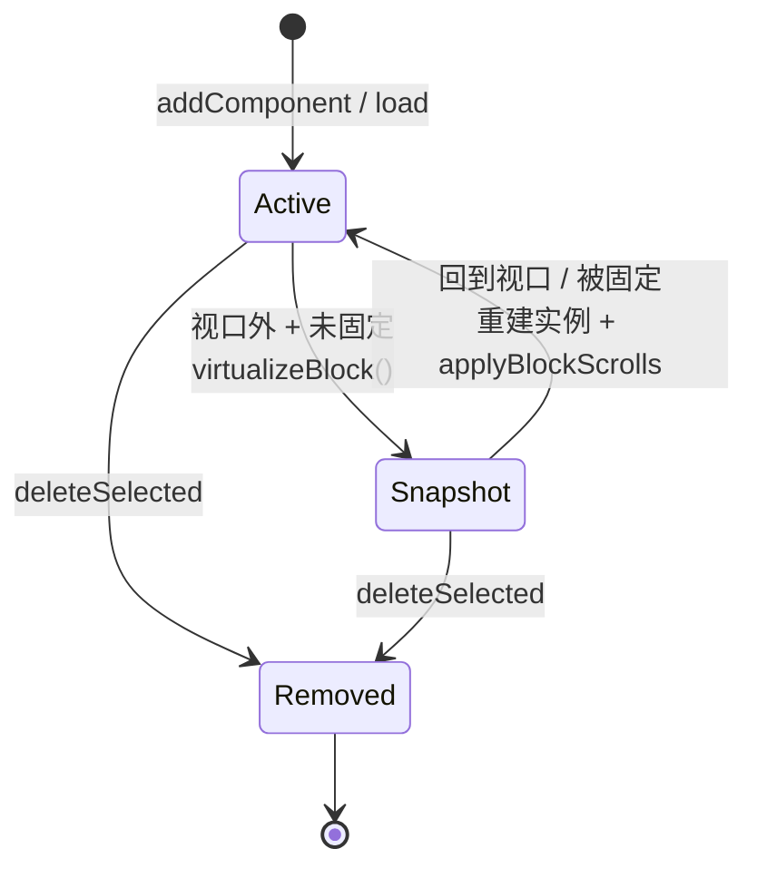
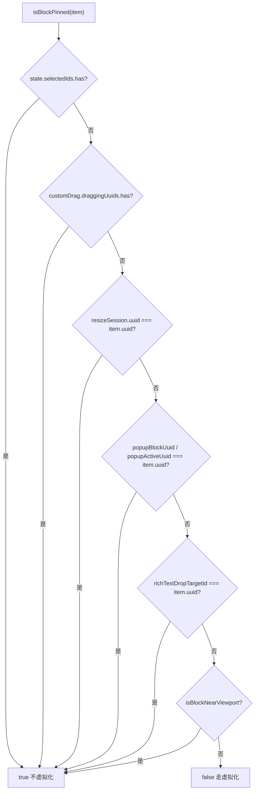
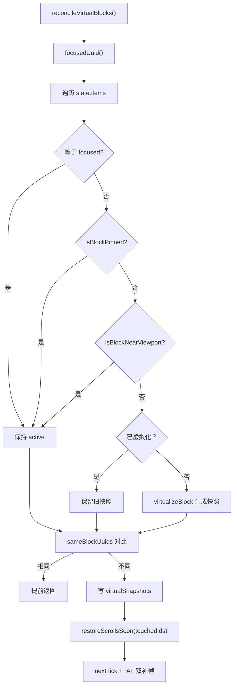
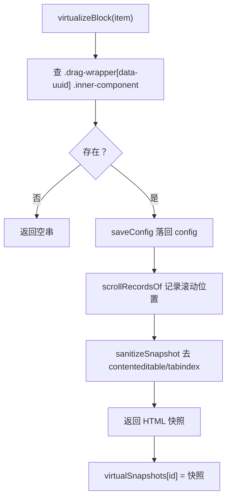
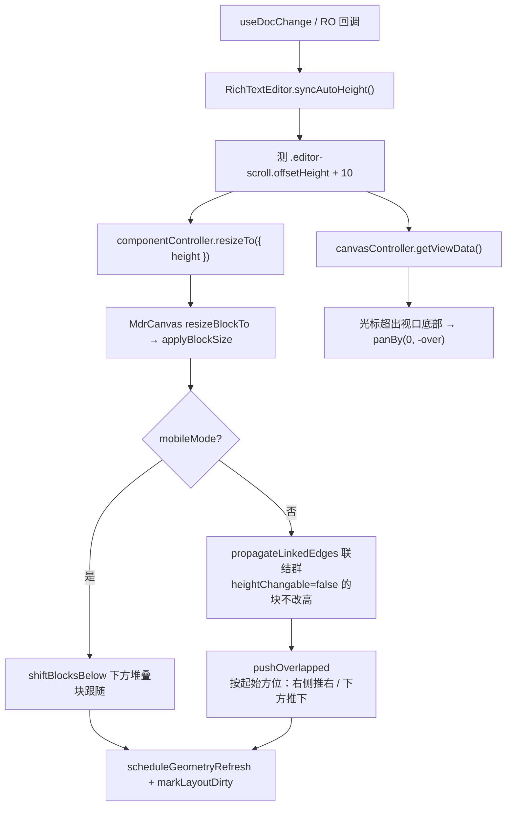

<!-- 最后验证: 2026-10-18 -->
# 05 块生命周期

## 三种状态

- **Active**：真实组件实例挂载，ProseMirror 完整运行
- **Snapshot**：视口外，实例销毁，只留 sanitized DOM 快照
- **Removed**：已删除

## 图 5.1 块虚拟化状态机

## 图 5.2 isBlockPinned 判定

> 以下情况永不虚拟化：选中 / 拖拽中 / resize 中 / popup 打开 / 富文本落点目标。

## 图 5.3 reconcileVirtualBlocks 主流程

## 图 5.4 virtualizeBlock 内部

> 顺序很重要：**先 saveConfig → 再记录滚动 → 最后克隆 HTML**。实例一去，doc 与 DOM 都取不到。

## 图 5.5 自动高度与光标跟随（组件内实现）

> `heightChangable` 由块组件注册项声明（富文本 autoHeight 时不可改高），画布与 base 共用同一判定；`isPanning` 由 `getViewData` 提供，拖拽平移期间组件不跟随光标。
> 组件自己调用 `resizeTo` 不受 changable 拦截；自动大小（如图片块）在尺寸落定后把两轴都置为不可变，手柄随之收掉。
>
> `pushOverlapped` 按**变更前**的起始矩形判断方位：原本贴在右侧的块横向右推（横向联结群跟随），原本在下方/底边贴合的块纵向推下；变宽后新产生的横向重叠不会再被误判成「下方块」，也不会把侧边块推到下面。

## 维护提示

- 新增"固定块"条件 → 更新图 5.2
- 改虚拟化顺序 → 更新图 5.4
- 改 autoHeight 推挤 → 更新图 5.5，并补充相关回归验证
- 自动高度的测量、`resizeTo` 与光标跟随都在 `RichTextEditor.vue` 内，画布只保留通用 `applyBlockSize`