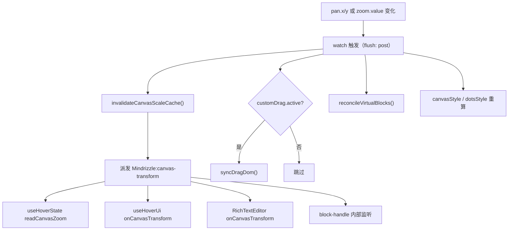
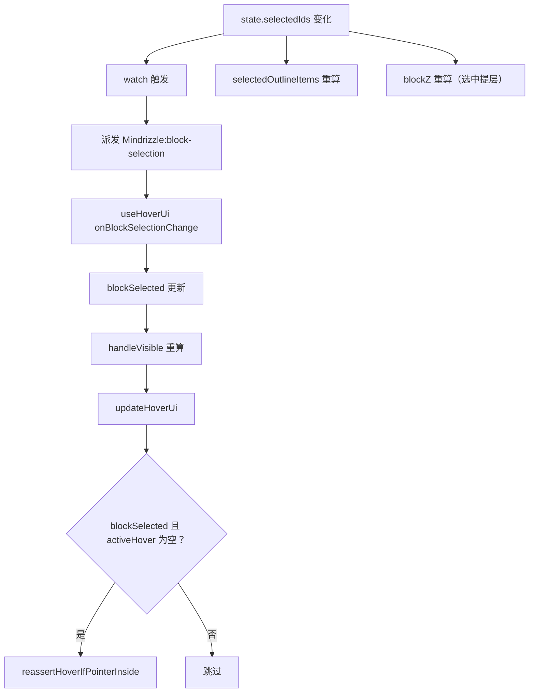
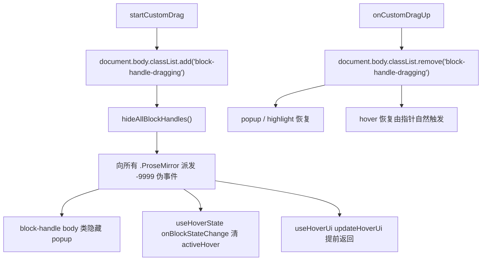
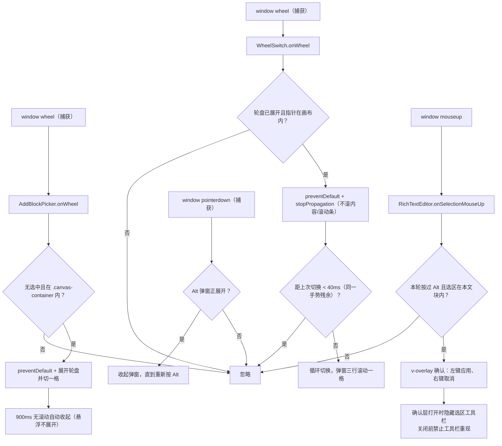
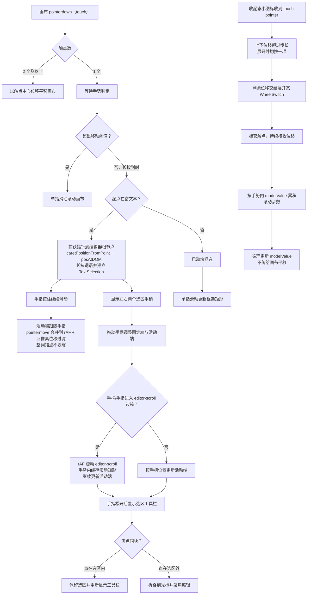
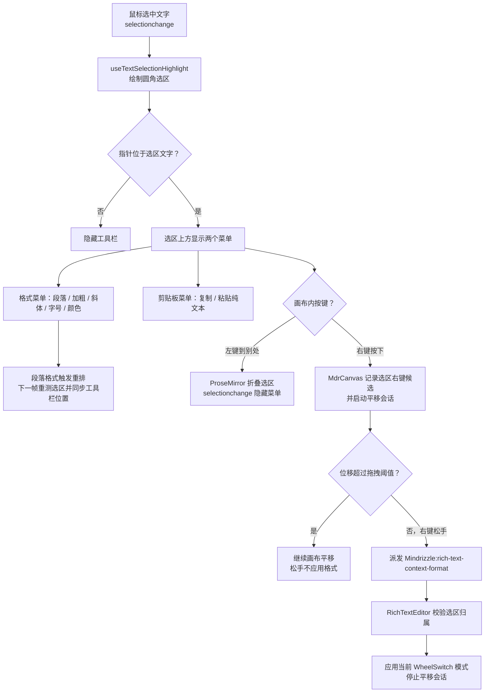
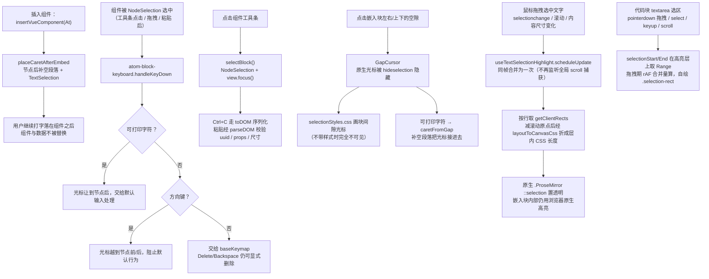

<!-- 最后验证: 2026-11-28 -->

# 07 事件连锁反应

> 事件契约见 02-contracts.md，本文件回答"派发之后发生了什么"。

## 图 7.1 pan / zoom 变化的连锁反应

## 图 7.2 块选中变化的连锁反应

## 图 7.3 拖拽开始/结束的全局信号

> `document.body.classList.contains('block-handle-dragging')` 是跨编辑器抑制 UI 的**全局 lock**。

## 图 7.4 右侧三态轮盘的滚轮切换

> 富文本格式模式与添加块共用 `WheelSwitch` 三态轮盘和 `ModeGrid` 图标网格，选择器统一 Teleport 到 `.canvas-container` 右侧中部。富文本锚点按住 Alt 展开轮盘；添加块锚点滚轮展开轮盘并切一格，停手 900ms 自动收起；两者悬浮都只展开图标网格，点击才切换，悬浮本身不改选中值。标题/字体颜色/背景高亮在下方挂详情轮盘：Alt+Ctrl+滚轮切换，悬浮展开网格；颜色详情为 12 色板 + 自定义取色器，Alt+Ctrl 时主轮盘让位。只有本轮按过 Alt 的选区才弹应用确认；选区上右键则直接应用当前 WheelSwitch 模式并取消画布平移；普通滚轮不再切格式，否则会与块内滚动冲突。

## 图 7.7 触摸画布手势

> 画布容器关闭浏览器默认触摸平移；短按不触发画布手势，单指滑动画布、双指按中心点平移。长按富文本时将触点捕获到编辑器根节点并选中命中的词语，随后显示起止手柄；按住继续滑动时活动端跟随手指，整词一侧不收缩，拖动手柄则只移动对应端；手柄或手指触及 `.editor-scroll` 边缘会 rAF 自动滚动并继续更新选区，松手后再显示工具栏，之后点在选区内保留选区、点在选区外才折叠到光标。长按选词不聚焦编辑器（移动端聚焦会弹键盘压缩视口），只有短按落光标才聚焦；手指按住期间给 ProseMirror 元素写内联 `user-select: none` 并关闭原生长按菜单，避免浏览器原生选区与自绘手柄同时出现（内联样式只改目标元素，避免类选择器重算整棵编辑子树）；拖动与手柄调整都合并到 rAF 并过滤亚像素位移，收尾用最终坐标补一帧，滚动边缘判定在手势内缓存 `editor-scroll` 矩形。手柄位置与高亮都由 ProseMirror 文档选区计算，避免浏览器原生选区因触点捕获而滞后。长按前容忍少量手指漂移，块手柄弹层不进入画布平移手势；链接与嵌入组件（`[data-node-view-root]`）不接管触摸手势，保留其原生交互；手势被 `pointercancel`/失焦打断时统一清理触点与鼠标事件屏蔽。长按代码输入区沿用原生选择；长按富文本但没有命中文字（内边距/空行）时退回选中整块，否则触屏没有入口能选中富文本块去移动或缩放；长按其它画布位置后移动则框选块，长按块后不移动会选中起始块。添加块小图标上的上下滑动首步即展开并切换，滑动跟踪挂在 window 捕获阶段（`setPointerCapture` 在画布缩放 ≠100% 时会被丢弃，手势会退化成点按），因此手指移出 36px 锚点也能继续累计；剩余位移由展开态 WheelSwitch 捕获并消费；轮盘覆盖透明锚点，保证右侧触摸也能开始手势；同一手势的滚动步数按当前模式累积，避免连续触摸事件丢步。触屏没有 hover，点按锚点同样能展开/收起图标网格作为备用切换入口；滚轮只有在块内滚动容器还能朝该方向滚动时才被它消费，滚到顶/底后交还轮盘。添加块预览与方向箭头只在可悬停的指针下显示（按 `(hover: hover)` 能力判定，窄桌面窗口照常显示）。

## 图 7.6 富文本选区工具栏与右键格式应用

> 工具栏 Teleport 到 `.canvas-floating-layer`，该层与 `.canvas` 同步 pan/zoom 并作为 `.canvas-container` 的同级叠层，使工具栏能压过 SideToolbar；位置由选区和视口空间计算，优先放在不遮挡选区的一侧，一侧放不下时才换到另一侧，并在视口边缘约束水平位置。`selectionchange`、块内滚动、`visualViewport`/window resize、内容重排、画布 zoom 变化都合并到 rAF 后再刷新工具栏与手柄；手势拖动与只读态直接短路隐藏，`hideTextSelectionToolbar` 幂等以免逐事件写 reactive。菜单（标题下拉、字号、字体/背景取色器）展开、指针停在工具栏上，或取色弹层仍挂载时，工具栏一律不收起——工具栏一卸载，取色器会跟着消失。触摸端没有 hover，交互态由 window 捕获阶段的 `pointerdown` 维护：目标落在 `.text-selection-toolbar` / `.text-selection-color-picker` / 选区手柄（含 Teleport 到 `.v-overlay-container` 的弹层）时置为交互中并直接返回，否则点取色弹窗会被当成"点外部"而收起整条工具栏并重置触摸选区。收起只在指针悬停移开时发生：松手点常落在选区外一像素、选区/内容刷新时指针也可能在矩形外，这两类刷新都不触发收起；`isTextSelectionDragging` 在 window 捕获阶段的 `pointerup`/`pointercancel` 兜底复位，避免编辑器内 DOM 被选区更新替换、mouseup 冒泡不到 window 时标记永久为 true 而让工具栏再也弹不出来。段落样式改变后等待渲染及下一帧重新测量选区，避免标题/正文重排后工具栏仍停留在旧位置；工具栏交互期间以 ProseMirror 文档选区作为定位来源，防止控件焦点切换让原生选区矩形过期。画布平移按住指针期间跳过选区几何测量，工具栏随同步变换层合成移动，松手后再刷新定位。入场/离场有淡入缩放过渡，菜单与选区之间有透明 hover 桥接并延迟收起。浮动工具栏按 Office 功能区分组：段落样式、字体切换、字号、颜色与剪贴板各自成组，使用 Vuetify 的紧凑密度和组件布局；字体颜色、背景颜色的名称与其它组一样放在控件下方，取色器弹层打开或应用颜色期间保持工具栏可见。颜色控件保留各自的清除按钮，功能区按可用宽度换行防止溢出。输入控件获得焦点时，选区高亮回退到 ProseMirror 文档选区绘制，避免原生焦点选区替换导致高亮消失。浮动工具栏与右侧 WheelSwitch 的「字号」详情菜单共用 `fontSize` mark；右侧详情首项可移除自定义字号。选区右键按下先进入平移候选，只有松手位移未超过阈值才应用当前 WheelSwitch 样式；拖拽超过阈值时保持原有画布平移行为。左键点击其它位置仍走 ProseMirror 默认折叠选区；但拖选文字时松手落在块外会以起止目标的公共祖先派发 `click`，这不是点空白，MdrCanvas 按 mousedown 起点是否在 `.editor-mount.ProseMirror` 内区分，保留块选中与文本选区。

## 图 7.5 富文本原子块（插入组件 / 公式块）的键盘与选区

> 插入组件与公式块都是 atom block：被 NodeSelection 选中时，ProseMirror 的默认输入语义是「替换选区」，一次按键就会连组件带数据一起删掉。因此插入命令不建立 NodeSelection，键盘入口统一经 `atom-block-keyboard.ts` 把光标让到节点之外；组件内容区继续 `stopPropagation` 保留业务输入，工具条承担「选中整块」的选择把手。
>
> 嵌入块底栏的「拖出成画布块 / 拖动改变大小」同样只能吃 `pointerdown`：工具条在 ProseMirror 内、触屏不会补发可用的 `mousemove`，所以起手与拖动全程走 pointer 事件（window 捕获 + `pointercancel` 收尾），按钮再加 `touch-action: none` 以免手指拖动被块内滚动吃掉。
>
> 原子块以 `inline-flex` 参与行内排版，块左右会留出可点击的空隙，PM 在那里只能放 GapCursor，而 `defineGapCursor()` 只带插件不带样式（`::selection`/`.ProseMirror-selectednode` 默认值也不随主题），三类选区样式统一收在 `selectionStyles.css`，它由 `RichTextEditor.vue` 随懒加载块一同引入。
>
> 文字选区要圆角只能自绘：`::selection` 不支持圆角，所以原生高亮置透明、按行铺圆角块；高亮层在 `.editor-scroll-shell` 里（不在 `.ProseMirror` 内，否则会被当成文档变更），坐标是 `.canvas` zoom 空间内的 CSS 长度，所以量到的 BCR 差值需先折回视觉、再除以 zoom（`layoutToCanvasCss`）。`selectionchange` / 块内滚动 / resize 统一走 `scheduleUpdate` 合并到一帧；不监听全局 `scroll` 捕获，因为画布平移时块内选区与滚动原点同步位移、相对位置不变。
>
> 嵌入块自己要接管选区时，用比 `:where(.editor-mount.ProseMirror) ::selection` 更高的优先级把原生高亮关掉：代码块就是按 `selectionStart/End` 在高亮层 `code` 上取 Range，再画到 textarea 上的 `.selection-layer`（两层同字体、滚动同步，坐标同样折回布局像素）。

## 维护提示

- 新增事件 → 更新 02-contracts + 本文件对应图
- 改事件监听顺序 → 更新图
