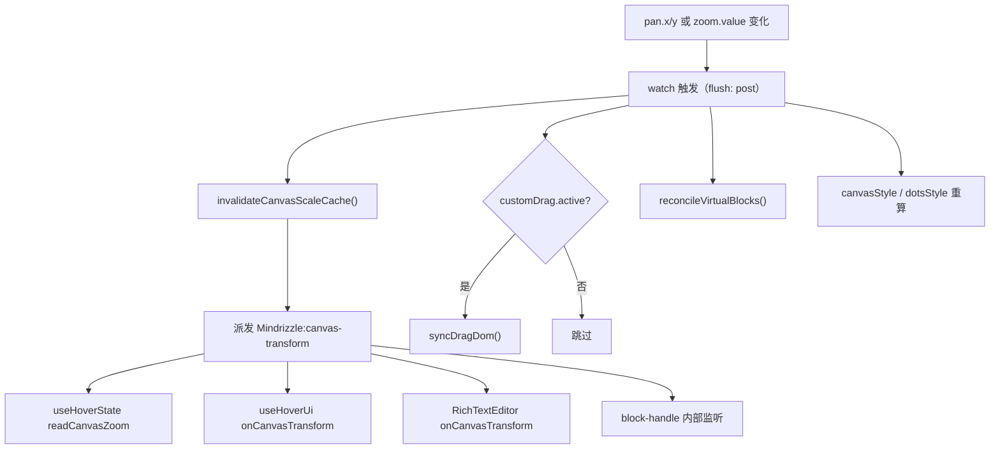
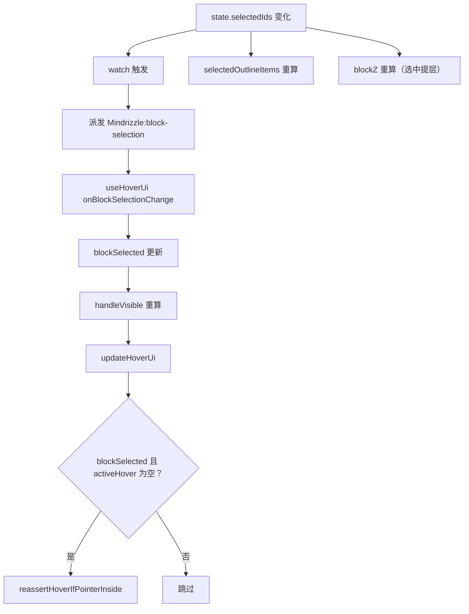
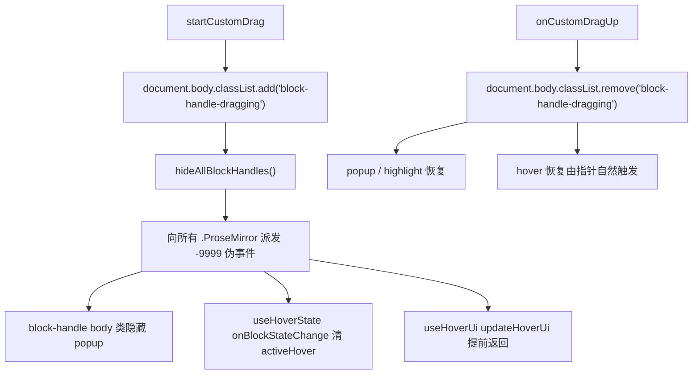
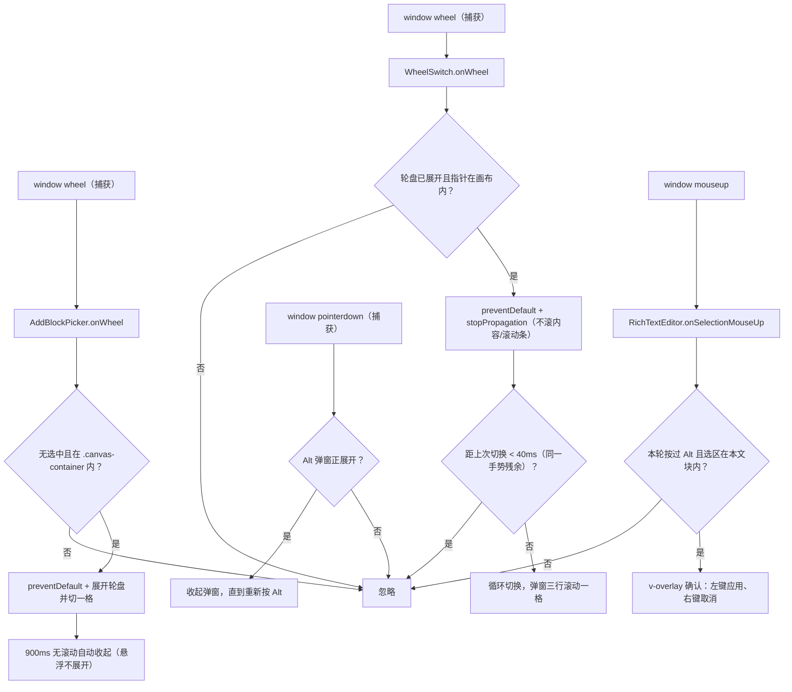

<!-- 最后验证: 2026-10-25 -->
# 07 事件连锁反应

> 事件契约见 02-contracts.md，本文件回答"派发之后发生了什么"。

## 图 7.1 pan / zoom 变化的连锁反应

## 图 7.2 块选中变化的连锁反应

## 图 7.3 拖拽开始/结束的全局信号

> `document.body.classList.contains('block-handle-dragging')` 是跨编辑器抑制 UI 的**全局 lock**。

## 图 7.4 右侧三态轮盘的滚轮切换

> 富文本格式模式与添加块共用 `WheelSwitch` 三态轮盘和 `ModeGrid` 图标网格，选择器统一 Teleport 到 `.canvas-container` 右侧中部。富文本锚点按住 Alt 展开轮盘；添加块锚点滚轮展开轮盘并切一格，停手 900ms 自动收起；两者悬浮都只展开图标网格，点击才切换，悬浮本身不改选中值。标题/字体颜色/背景高亮在下方挂详情轮盘：Alt+Ctrl+滚轮切换，悬浮展开网格；颜色详情为 12 色板 + 自定义取色器，Alt+Ctrl 时主轮盘让位。只有本轮按过 Alt 的选区才弹应用确认；普通滚轮不再切格式，否则会与块内滚动冲突。

## 维护提示

- 新增事件 → 更新 02-contracts + 本文件对应图
- 改事件监听顺序 → 更新图