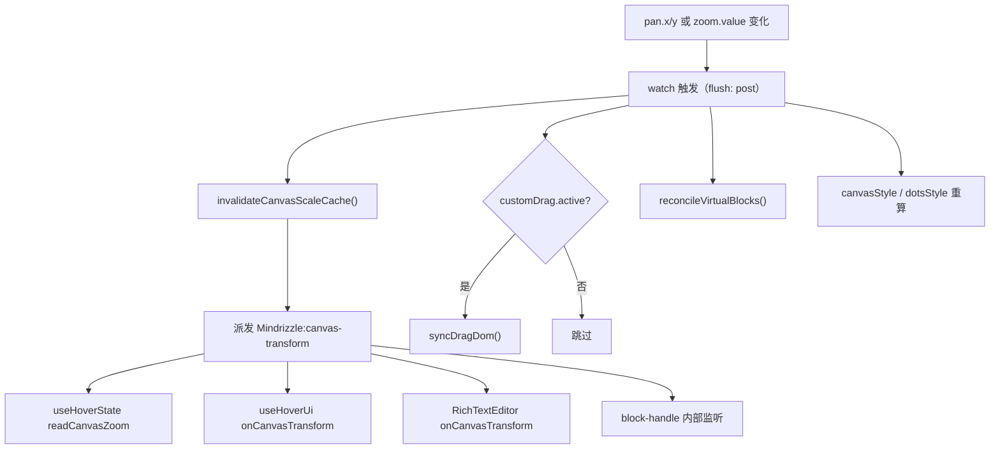
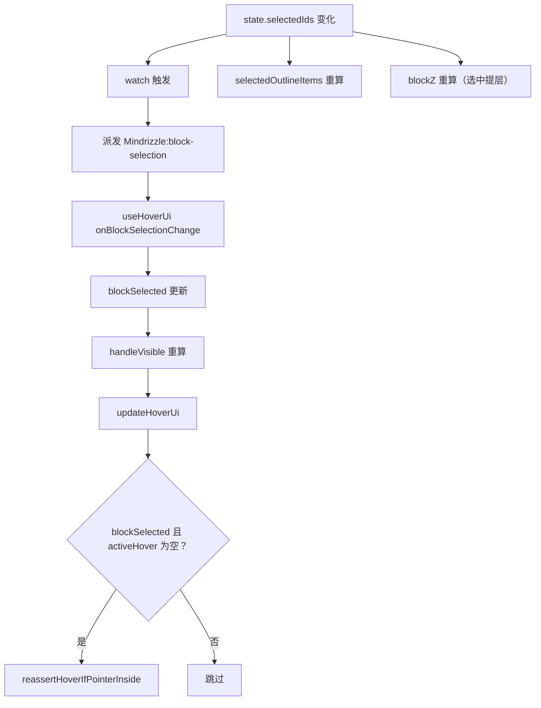
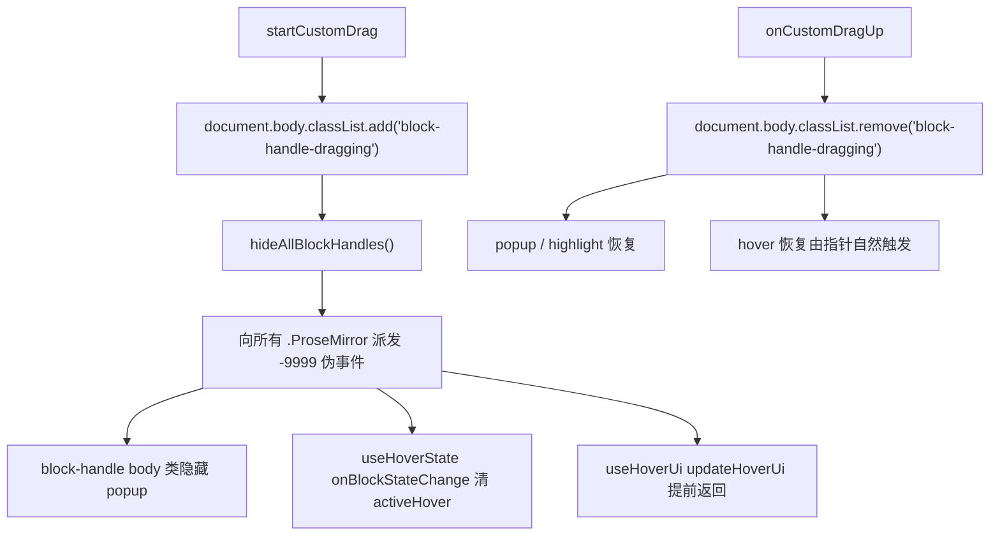
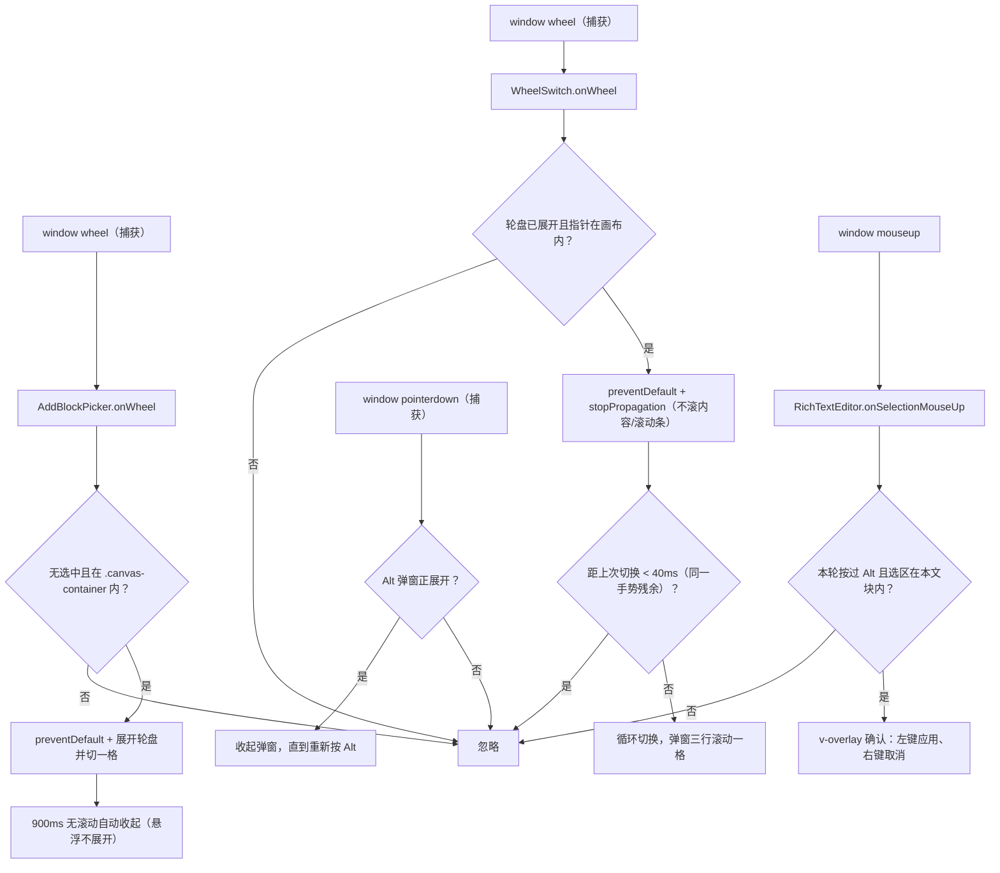
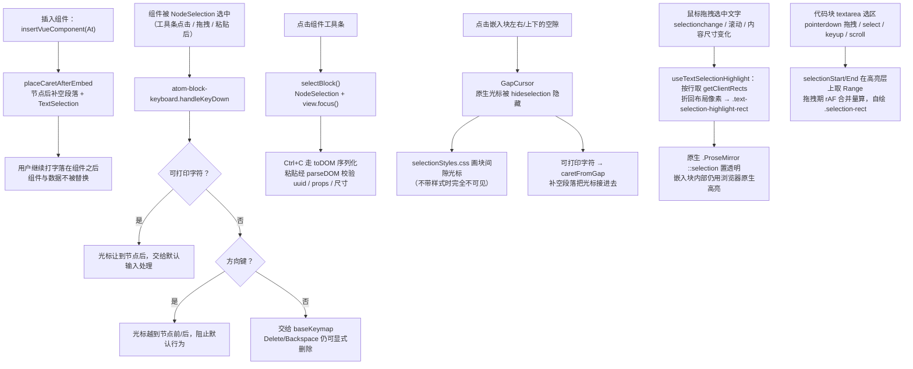

<!-- 最后验证: 2026-10-30 -->
# 07 事件连锁反应

> 事件契约见 02-contracts.md，本文件回答"派发之后发生了什么"。

## 图 7.1 pan / zoom 变化的连锁反应

## 图 7.2 块选中变化的连锁反应

## 图 7.3 拖拽开始/结束的全局信号

> `document.body.classList.contains('block-handle-dragging')` 是跨编辑器抑制 UI 的**全局 lock**。

## 图 7.4 右侧三态轮盘的滚轮切换

> 富文本格式模式与添加块共用 `WheelSwitch` 三态轮盘和 `ModeGrid` 图标网格，选择器统一 Teleport 到 `.canvas-container` 右侧中部。富文本锚点按住 Alt 展开轮盘；添加块锚点滚轮展开轮盘并切一格，停手 900ms 自动收起；两者悬浮都只展开图标网格，点击才切换，悬浮本身不改选中值。标题/字体颜色/背景高亮在下方挂详情轮盘：Alt+Ctrl+滚轮切换，悬浮展开网格；颜色详情为 12 色板 + 自定义取色器，Alt+Ctrl 时主轮盘让位。只有本轮按过 Alt 的选区才弹应用确认；普通滚轮不再切格式，否则会与块内滚动冲突。

## 图 7.5 富文本原子块（插入组件 / 公式块）的键盘与选区

> 插入组件与公式块都是 atom block：被 NodeSelection 选中时，ProseMirror 的默认输入语义是「替换选区」，一次按键就会连组件带数据一起删掉。因此插入命令不建立 NodeSelection，键盘入口统一经 `atom-block-keyboard.ts` 把光标让到节点之外；组件内容区继续 `stopPropagation` 保留业务输入，工具条承担「选中整块」的选择把手。
>
> 原子块以 `inline-flex` 参与行内排版，块左右会留出可点击的空隙，PM 在那里只能放 GapCursor，而 `defineGapCursor()` 只带插件不带样式（`::selection`/`.ProseMirror-selectednode` 默认值也不随主题），三类选区样式统一收在 `selectionStyles.css`，它由 `RichTextEditor.vue` 随懒加载块一同引入。
>
> 文字选区要圆角只能自绘：`::selection` 不支持圆角，所以原生高亮置透明、按行铺圆角块；高亮层在 `.editor-scroll-shell` 里（不在 `.ProseMirror` 内，否则会被当成文档变更），坐标是布局像素，随 `.canvas` 的 zoom 自动缩放。
>
> 嵌入块自己要接管选区时，用比 `:where(.editor-mount.ProseMirror) ::selection` 更高的优先级把原生高亮关掉：代码块就是按 `selectionStart/End` 在高亮层 `code` 上取 Range，再画到 textarea 上的 `.selection-layer`（两层同字体、滚动同步，坐标同样折回布局像素）。

## 维护提示

- 新增事件 → 更新 02-contracts + 本文件对应图
- 改事件监听顺序 → 更新图