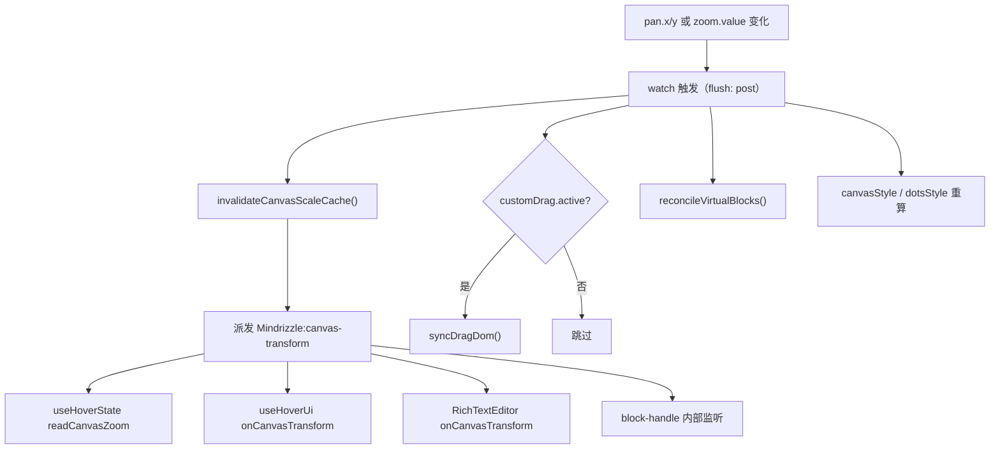
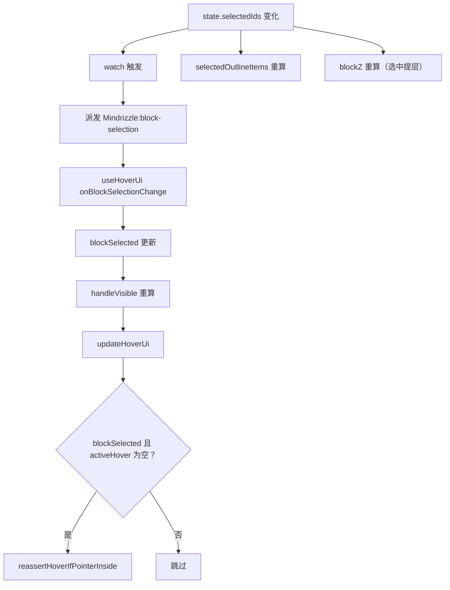
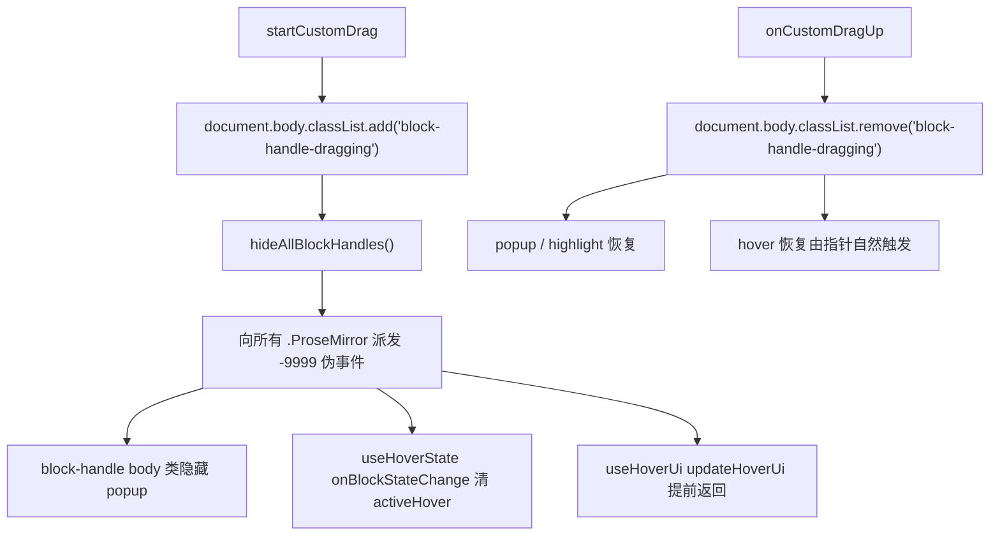
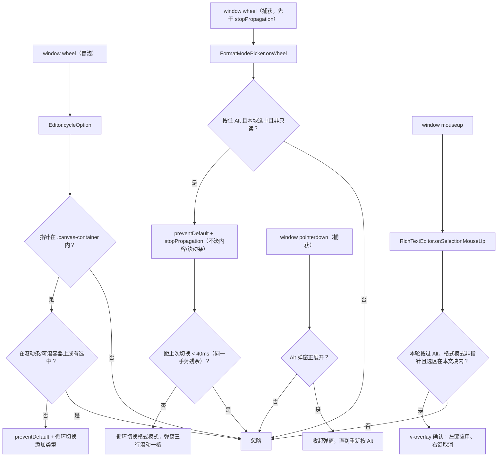

<!-- 最后验证: 2026-10-25 -->
# 07 事件连锁反应

> 事件契约见 02-contracts.md，本文件回答"派发之后发生了什么"。

## 图 7.1 pan / zoom 变化的连锁反应

## 图 7.2 块选中变化的连锁反应

## 图 7.3 拖拽开始/结束的全局信号

> `document.body.classList.contains('block-handle-dragging')` 是跨编辑器抑制 UI 的**全局 lock**。

## 图 7.4 工具栏按钮组的滚轮切换

> 富文本格式模式的生命周期完全在块内部（含应用与确认 overlay）；选择器由块 Teleport 到 `.canvas-container` 右上角，常驻显示当前模式图标，按住 Alt 向左展开上一/当前/下一模式三行。悬浮锚点会展开全部模式图标网格（两列三行，点击可切换，`v-tooltip` 显示名称与简介），与 Alt 轮盘互斥。开始点选/框选会先收起 Alt 弹窗，只有本轮按过 Alt 的选区才弹确认。普通滚轮不再切格式，否则会与块内滚动冲突。

## 维护提示

- 新增事件 → 更新 02-contracts + 本文件对应图
- 改事件监听顺序 → 更新图