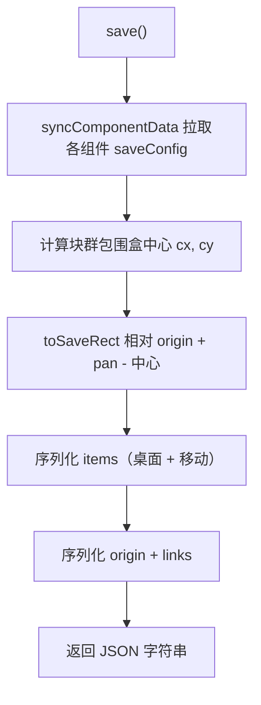
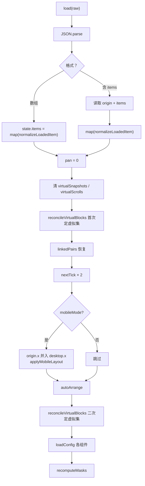
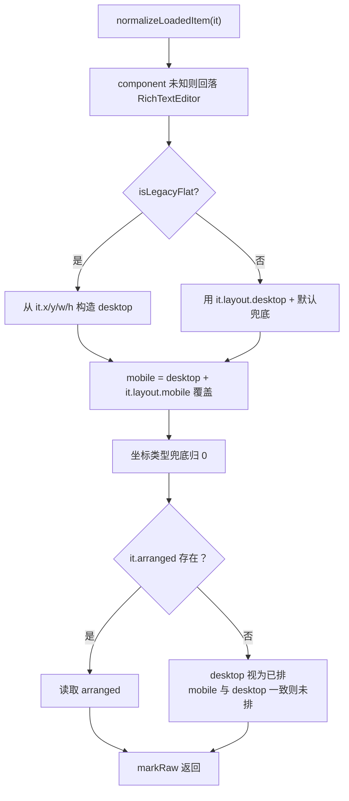
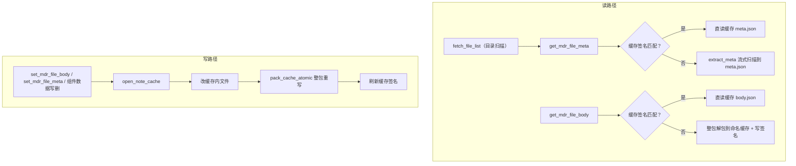
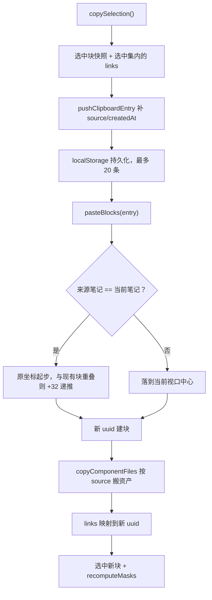

<!-- 最后验证: 2026-11-01 -->

# 08 序列化与兼容

## 图 8.1 save 数据流

## 图 8.2 load 数据流

## 图 8.3 normalizeLoadedItem 兼容分支

## 组件私有文件（ComponentsData）

- 归档内固定结构：`meta.json`、`body.json`、`ComponentsData/<组件 UUID>/<相对路径>`，随 `.mdrf` 一起打包。
- 前端唯一入口 `src/utils/componentDataStore.ts`，URL 形如 `mdrfcd://<笔记名>/<组件 UUID>/<相对路径>`。
- 写入/删除：与正文共用同一份命名缓存（命中则不解包）→ 改文件 → 原子重打包，不再额外失效暂存区。
- 读取/list/exists 直接从归档流里找条目，不落盘。

## 图 8.5 归档读写与缓存

- 缓存目录 `Mindrizzle_<pid>_<归档路径>` 跨调用存活；签名文件 `<目录>.synced` 记录归档大小与 mtime，
  放在目录外避免被 `pack_cache` 打进 `.mdrf`。归档被外部改写时签名不匹配，自动整包重解。
- **打包不可省**：`.mdrf` 是整包 tar(+gzip)，任何写入都要全量重写；优化点只在「不重复解包」——
  打开→保存→关闭→再打开只需一次解包。
- 失效点：`move_*` / `delete_mdrf_file` 调 `invalidate_named`；`rename_mdrf_file` 把缓存目录一起改名（签名不变，继续可用），
  需要同时改标题时在改名前后的同一份缓存上再打包一次。
- 重命名只在「标题 == 旧文件名」时才传 `mdrFileInfo`，用户自定义过标题的笔记纯改名不会整包重写。

## 笔记定位（工作区 / 外部文件）

- 默认工作区：只传 `fileName`，后端拼到用户文档目录 `Mindrizzle/`。
- 自定义工作区：额外传 `dir`（绝对目录），归档为 `dir/<fileName>.mdrf`。
- 外部文件：传 `filePath`（绝对路径），后端直接读写该归档，保存写回原文件。
- `fetch_file_list` / `is_file_name_valid` / `create_mdr_file` / `get|set_mdr_file_body` / 组件数据命令均接受同一组定位参数；缓存键改用归档绝对路径，避免不同工作区同名笔记互相覆盖。
- 网页端上传的 `.mdrf` 解包后只作为**外部文件副本**存进 IndexedDB（不写文件索引），打开与保存都按副本名读写。
- 「移动到工作区」：桌面端由 `move_mdrf_file` 把归档移进目标目录并从外部列表移除；网页端 `moveLocalNoteToWorkspace` 把副本名补进文件索引。

## 图 8.4 跨画布剪贴板

- 剪贴板是应用级共享数据（`src/utils/blockClipboard.ts`），跨便签保留历史；内容相同的复制只刷新时间并提到最前。
- 块只看 `config` / `layout` / `arranged`，不依赖原块实例；粘贴后原块再改不会影响已复制内容。
- 资产文件按 `source`（fileName + dir/filePath）定位：`ComponentDataStore` 支持显式传入来源笔记，`copyComponentFiles` 从源笔记读、写入当前笔记。
- 移动端粘贴 x 恒 0，不做横向偏移与重叠避让。

## 兼容规则速查

- 块标识字段为 `uuid`（放置时生成、持久化），不做旧 `id` 字段兼容
- 旧扁平格式（`it.x/y/w/h`）→ 转为 `layout.desktop`
- `origin` 坐标归一化：保存时减去块群中心，加载时归零 pan
- 移动端宽度运行时拉伸，不持久化
- `arranged` 缺失时：desktop 视为已排，mobile 若与 desktop 一致则视为未排

## 维护提示

- 新增字段 → 更新图 8.1、8.3
- 改兼容规则 → 更新图 8.3 + 加测试
- 改复制/粘贴语义 → 更新图 8.4
