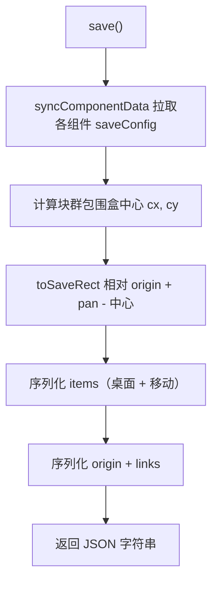
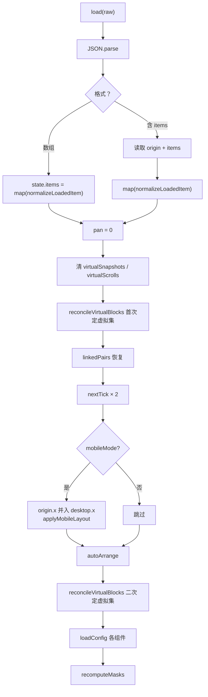
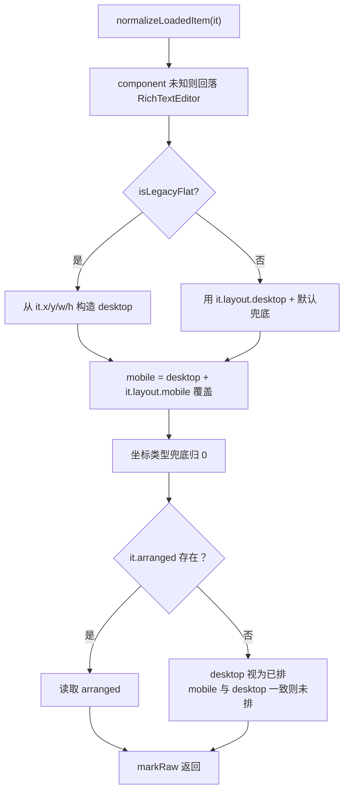

<!-- 最后验证: 2026-10-18 -->
# 08 序列化与兼容

## 图 8.1 save 数据流

## 图 8.2 load 数据流

## 图 8.3 normalizeLoadedItem 兼容分支

## 组件私有文件（ComponentsData）

- 归档内固定结构：`meta.json`、`body.json`、`ComponentsData/<组件 UUID>/<相对路径>`，随 `.mdrf` 一起打包。
- 前端唯一入口 `src/utils/componentDataStore.ts`，URL 形如 `mdrfcd://<笔记名>/<组件 UUID>/<相对路径>`。
- 写入/删除：解包到临时缓存 → 改文件 → 原子重打包，并失效同名暂存区（否则后续保存会用旧缓存覆盖组件数据）。
- 读取/list/exists 直接从归档流里找条目，不落盘。

## 笔记定位（工作区 / 外部文件）

- 默认工作区：只传 `fileName`，后端拼到用户文档目录 `Mindrizzle/`。
- 自定义工作区：额外传 `dir`（绝对目录），归档为 `dir/<fileName>.mdrf`。
- 外部文件：传 `filePath`（绝对路径），后端直接读写该归档，保存写回原文件。
- `fetch_file_list` / `is_file_name_valid` / `create_mdr_file` / `get|set_mdr_file_body` / 组件数据命令均接受同一组定位参数；缓存键改用归档绝对路径，避免不同工作区同名笔记互相覆盖。
- 网页端上传的 `.mdrf` 解包后只作为**外部文件副本**存进 IndexedDB（不写文件索引），打开与保存都按副本名读写。
- 「移动到工作区」：桌面端由 `move_mdrf_file` 把归档移进目标目录并从外部列表移除；网页端 `moveLocalNoteToWorkspace` 把副本名补进文件索引。

## 兼容规则速查
- 块标识字段为 `uuid`（放置时生成、持久化），不做旧 `id` 字段兼容
- 旧扁平格式（`it.x/y/w/h`）→ 转为 `layout.desktop`
- `origin` 坐标归一化：保存时减去块群中心，加载时归零 pan
- 移动端宽度运行时拉伸，不持久化
- `arranged` 缺失时：desktop 视为已排，mobile 若与 desktop 一致则视为未排

## 维护提示

- 新增字段 → 更新图 8.1、8.3
- 改兼容规则 → 更新图 8.3 + 加测试