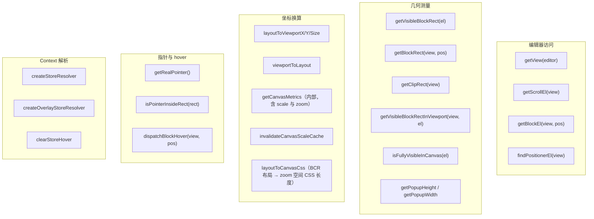
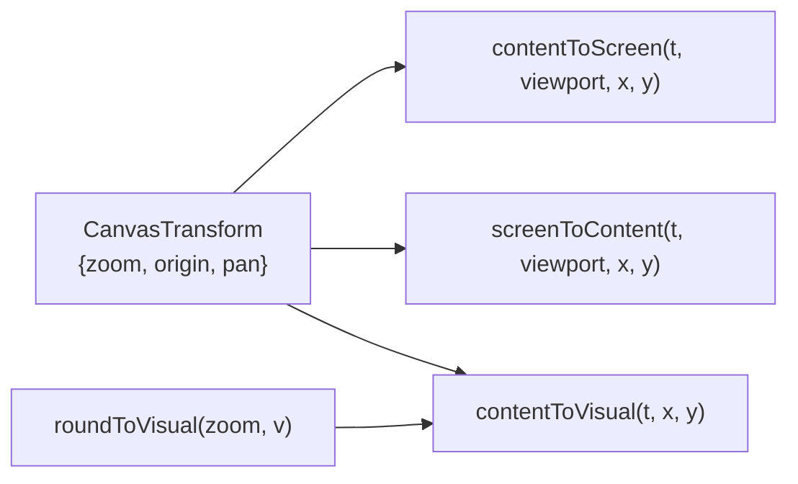
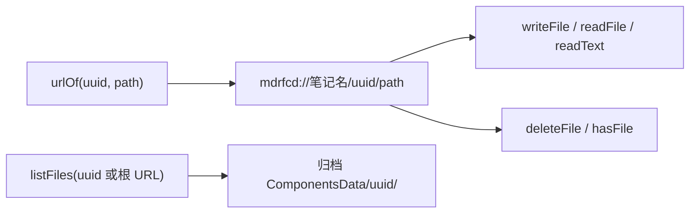

<!-- 最后验证: 2026-11-08 -->

# 10 工具函数索引

## 图 10.1 blockHandleUtils 函数分类

> `getClipRect` 的输入横跨两个坐标空间：容器 BCR 是视觉坐标、块内滚动容器 BCR 在 `.canvas` 的 zoom 空间内，所以先经 `layoutToViewportX/Y` 折到视觉再求交；自绘高亮层（富文本选区、代码块选区）在 zoom 空间内，量到的 BCR 差值须走 `layoutToCanvasCss` 才落到层内 CSS 长度。

## 图 10.2 canvasCoords 函数

## 图 10.3 ComponentDataStore

## 使用原则

- **编辑器内代码**：只用 `blockHandleUtils`，不要直接读 BCR 做换算
- **画布内代码**：只用 `canvasCoords`，不要自己拼公式
- **跨边界**：clientX/Y 是唯一共同的坐标空间

## 维护提示

- 新增换算函数 → 更新图 10.1 或 10.2
- 函数归类变化 → 更新对应图
