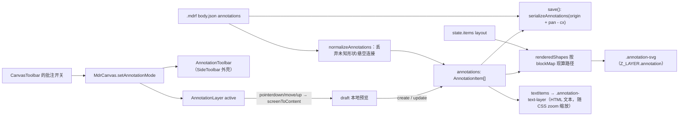
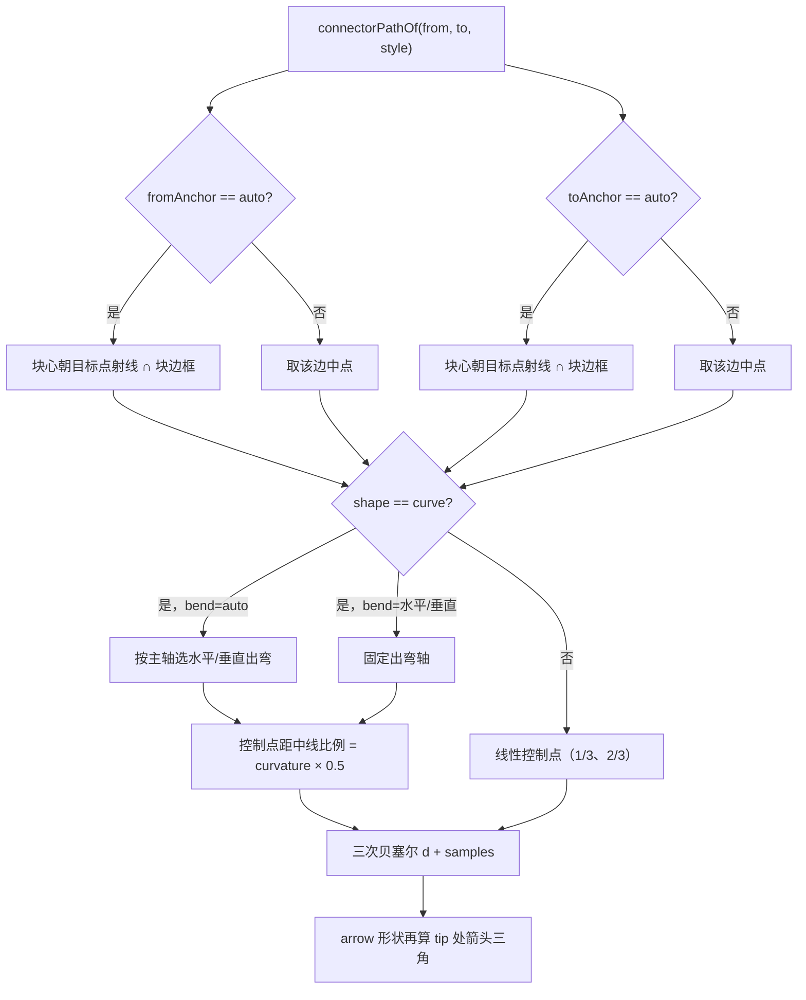
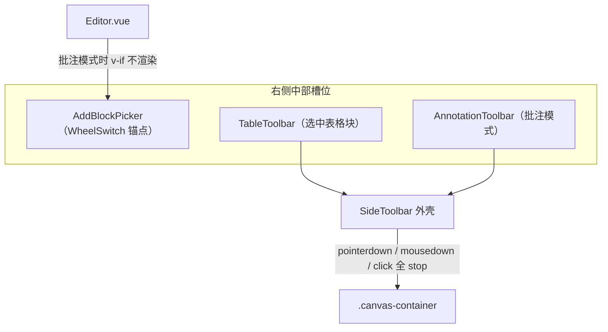

<!-- 最后验证: 2026-11-24 -->

# 12 批注模式

## 心智模型

1. **批注与块共用 content 坐标系**：笔画点、连接线端点、文本框左上角都按块布局坐标存储，`.canvas` 的 pan/zoom 一起吃变换。
2. **连接线不存坐标，只存两端块 uuid**：每次渲染按块当前 layout 现算端点，所以移动/缩放块时箭头自动跟随；锚边与弯曲方式随连接线持久化。
3. **批注层永远显示，捕捉层只在批注模式存在**：`annotation` 层 `pointer-events: none`，绘制期间由 `.annotation-catcher` 独占指针；编辑文本框时捕捉层临时 `pointer-events: none` 让指针落到 textarea。
4. **颜色走 CSS 变量**：每条批注把 `--annotation-color` 写在自身节点上，SVG/文本统一读 `var(--annotation-color, --v-theme-error)`，不要写死内联 `stroke`/`fill`。

## 图 12.1 批注数据流

## 图 12.2 连接线端点求解

## 工具与语义

| 工具   | 行为                                                              |
| ------ | ----------------------------------------------------------------- |
| select | 点击批注选中并打开设置菜单（锚点/弯曲/颜色/字号），空点取消       |
| pen    | 从按下点开始收集点，最小步长 2 视觉像素，rAF 合并入点             |
| line   | 从起始块拖到目标块，生成两端锚定的直线                            |
| arrow  | 同上，末端追加箭头三角                                            |
| curve  | 同上，出弯方向与曲率可调                                          |
| text   | 点击空白处新建文本框并就地编辑；点已有文本则继续编辑              |
| eraser | 按指针到折线/采样曲线的距离判定，阈值 10 视觉像素；文本框按包围盒 |

- 文本框以 `(x, y)` 为左上角，宽度/字号可调，普通展示渲染在 `.annotation-text-layer`（HTML），随 `.canvas` 的 CSS `zoom` 一起缩放。
- 编辑态 textarea 单独 Teleport 到 `.canvas-container`，按视觉坐标与 `zoom` 换算尺寸，并压在 `Z_LAYER.annotationEditor`（1008）上；捕捉层始终保持 `pointer-events: auto`，因此编辑期的点击不会穿透去新建文本或触发画布/块操作。
- 失焦、切工具或退出批注都会提交；`Esc` 取消，`Ctrl+Enter` 提交。正在编辑时点击画布只提交并吃掉该次按下。
- 多颜色批注：工具栏颜色菜单决定新绘制颜色，选中已有批注后改色立即生效。

- 连接工具必须**起点落在块上**，终点也落在块上且不是同一块才落库，否则丢弃。
- 拖拽标尺：`blocks` 由画布按 `blockZ` 升序传入，命中测试从尾往前找最上层块。
- 批注与块共用单一画布坐标系，任意视口尺寸都使用相同的批注逻辑。

## 持久化与清理

- 保存格式：`annotations: AnnotationItem[]`，笔画点、文本框 `x/y` 按 `origin + pan - cx/cy` 归一化；连接线只存两端 uuid，外加可选 `fromAnchor` / `toAnchor` / `bend` / `curvature`；所有批注可带 `color`。
- 加载：`normalizeAnnotations` 校验形状枚举、锚点/弯曲枚举、点坐标有限性、颜色十六进制与字号/宽度范围，并剔除两端块不存在的连接。
- 删块（`deleteSelected` / 拖出成组件）与 `origin` 重定位都会同步维护批注，避免悬空箭头与坐标漂移；文本框随 `origin` 平移。

## 图 12.3 工具条槽位与 WheelSwitch

- 两个浮层工具条共用 `Core/SideToolbar.vue`：桌面贴右侧中部，窄屏为底部居中上移 60px，宽度随内容自适应。
- 槽位互斥由宿主控制：批注模式隐藏 `AddBlockPicker`，选中表格块时隐藏添加块锚点，退出后自动回位。
- WheelSwitch 的滚轮展开监听挂在 window 捕获阶段，只认 `.canvas-container` 内的 wheel；工具条在 `Z_LAYER.formatModePicker`（1010，高于捕捉层 1007）且吞掉指针事件，所以滚轮与点击都不会穿透到画布或 WheelSwitch。

## 维护提示

- 新增工具 → 同步 `AnnotationTool` 联合类型、工具栏工具按钮/菜单与本表
- 改坐标归一化 → 同步图 12.1 与 08-save-load；文本框要像笔画一样平移
- 新增批注样式（颜色/粗细）必须走 `AnnotationLayer` 的 scoped CSS 与 `--annotation-color` 变量，不要写内联 SVG 颜色
- 工具栏主列只放高频按钮，颜色、连接线形状、选中项参数都放二级 `v-menu`，避免侧栏过高
- 批注侧栏与画布工具条必须同宽：配色按钮等非图标按钮要锁 `28px`，`small` 图标按钮本身 28px，两侧 padding 均为 4px
- 文本框命中按估算包围盒（`textBoxOf`），调整字号/宽度时同步估算公式
- 文本框编辑器坐标走 `toViewport`（content → 容器视觉坐标），改缩放换算时同步这里与 `zIndex.ts`
