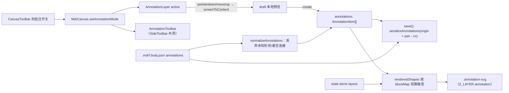
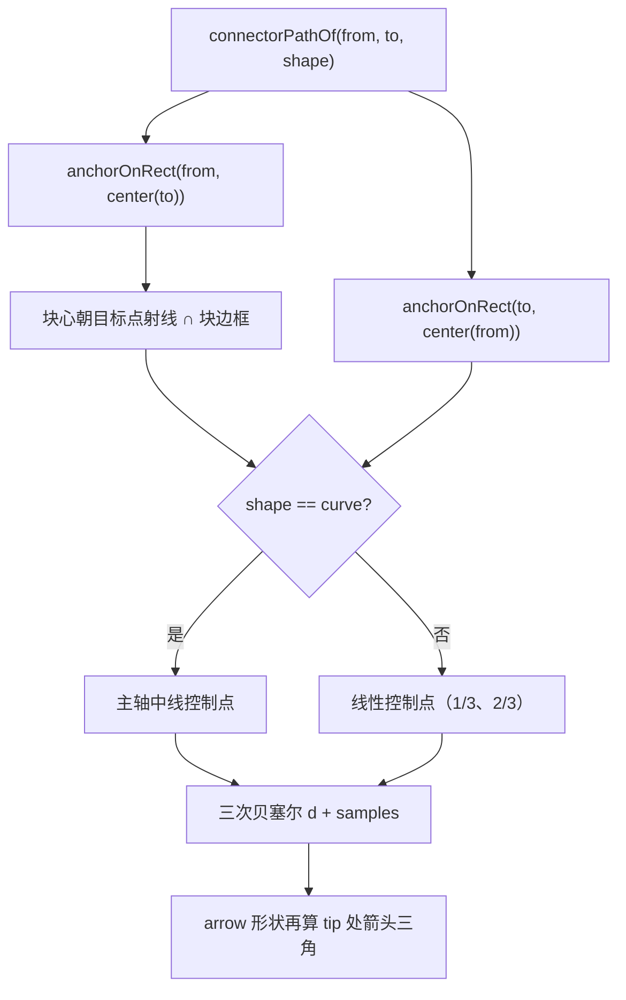
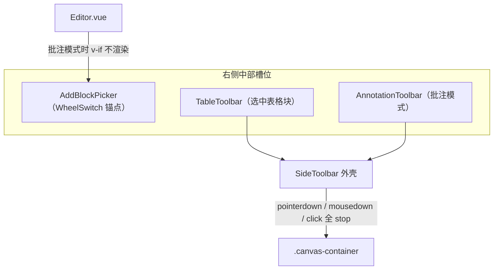

<!-- 最后验证: 2026-11-07 -->

# 12 批注模式

## 心智模型

1. **批注与块共用 content 坐标系**：笔画点、连接线端点都按块布局坐标存储，`.canvas` 的 pan/zoom 一起吃变换。
2. **连接线不存坐标，只存两端块 uuid**：每次渲染按块当前 layout 现算端点，所以移动/缩放块时箭头自动跟随。
3. **批注层永远显示，捕捉层只在批注模式存在**：`annotation` 层 `pointer-events: none`，绘制期间由 `.annotation-catcher` 独占指针。

## 图 12.1 批注数据流

## 图 12.2 连接线端点求解

## 工具与语义

| 工具   | 行为                                                     |
| ------ | -------------------------------------------------------- |
| pen    | 从按下点开始收集点，最小步长 2 视觉像素，rAF 合并入点    |
| line   | 从起始块拖到目标块，生成两端锚定的直线                   |
| arrow  | 同上，末端追加箭头三角                                   |
| curve  | 同上，出弯方向取主轴中线                                 |
| eraser | 按指针到折线/采样曲线的距离判定，阈值 10 视觉像素        |

- 连接工具必须**起点落在块上**，终点也落在块上且不是同一块才落库，否则丢弃。
- 拖拽标尺：`blocks` 由画布按 `blockZ` 升序传入，命中测试从尾往前找最上层块。
- 批注与块共用单一画布坐标系，任意视口尺寸都使用相同的批注逻辑。

## 持久化与清理

- 保存格式：`annotations: AnnotationItem[]`，笔画点按 `origin + pan - cx/cy` 归一化，连接线只有 uuid。
- 加载：`normalizeAnnotations` 校验形状枚举、点坐标有限性，并剔除两端块不存在的连接。
- 删块（`deleteSelected` / 拖出成组件）与 `origin` 重定位都会同步维护批注，避免悬空箭头与坐标漂移。

## 图 12.3 工具条槽位与 WheelSwitch

- 两个浮层工具条共用 `Core/SideToolbar.vue`：桌面贴右侧中部，窄屏为底部居中上移 60px，宽度随内容自适应。
- 槽位互斥由宿主控制：批注模式隐藏 `AddBlockPicker`，选中表格块时隐藏添加块锚点，退出后自动回位。
- WheelSwitch 的滚轮展开监听挂在 window 捕获阶段，只认 `.canvas-container` 内的 wheel；工具条在 `Z_LAYER.formatModePicker`（1010，高于捕捉层 1007）且吞掉指针事件，所以滚轮与点击都不会穿透到画布或 WheelSwitch。

## 维护提示

- 新增工具 → 同步 `AnnotationTool` 联合类型、工具栏 `ANNOTATION_TOOLS` 与本表
- 改坐标归一化 → 同步图 12.1 与 08-save-load
- 新增批注样式（颜色/粗细）必须走 `AnnotationLayer` 的 scoped CSS，不要写内联 SVG 颜色
