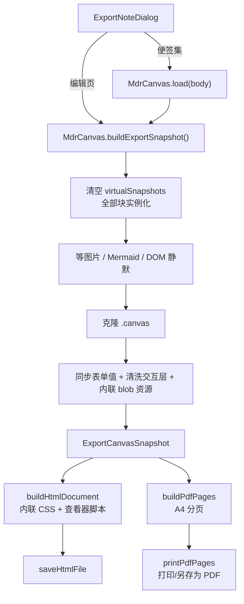

<!-- 最后验证: 2026-11-22 -->

# 13 HTML / PDF 导出

## 心智模型

1. **导出不重新渲染**：`MdrCanvas` 临时取消虚拟化，直接克隆当前 `.canvas`（含块壳、链接线、批注 SVG），因此导出结果与屏幕上一致。
2. **克隆后清洗**：去掉手柄、设置浮层、选中描边、vxe 悬停行与 `contenteditable`，再同步 input 的实时 value（表格/任务块的值不在 HTML 特性里）。
3. **主题固定浅色**：v-sheet 会把 `v-theme--dark` 写到自己身上，导出时移除该主题类，并用探针读取浅色变量内联到根节点；vxe 用 `data-vxe-ui-theme="light"` 覆盖。
4. **HTML 是独立文件**：内联应用 CSS、主题变量与块 DOM，附带只读查看器脚本（拖动/滚轮/双指/方向键/0 适应）。
5. **PDF 走分页 + 打印**：按 A4 宽度缩放整个画布，纵向切片成分页 DOM；预览复用同一份分页 HTML，导出调用 `window.print()` / Tauri `print_main_webview`。

## 图 13.1 导出数据流

## 关键约束

- 导出期间 `isCapturingExport` 必须拦住 `reconcileVirtualBlocks`，否则视口外的 Mermaid 会被换成源码快照。
- Mermaid 处于「编辑源码」时先点回预览；等待 `.mermaid-preview svg` 或 `.mermaid-error` 才算就绪。
- `blob:` 图片（图片块、附件预览）必须转 data URL，否则导出文件里是空白。
- 主题变量、vxe 色板都以**浅色**导出：深色背景直接打印会糊成黑块。
- PDF 的 `.mdr-page` 为 794×1123px（A4 @96dpi），打印时以 210×297mm 输出，不要改成自适应高度。

## 维护提示

- 新增块类型依赖新的异步资源（视频、画布）→ 在 `waitForExportStable` 增加就绪判定，或在块定义里提供自绘快照。
- 新增加交互浮层 → 同步 `exportAssets.ts` 的 `INTERACTIVE_SELECTORS`。
- 改主题/深色切换逻辑 → 回归图 13.1 的浅色固定路径。
